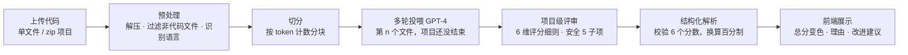

<div align="center">

# ⚖️ GPT_Judger

**LLM-as-a-Judge for Code — 一个 2024 年 1 月的早期原型**

用 GPT-4 按评分细则给代码打分：6 个维度 · 安全细分 5 项 · 多文件项目分块评审


</div>

> [!NOTE]
> **这份 README 是 2026 年 10 月回头补写的。** 代码停留在 2024-01-19 至 2024-03-11（23 次提交，v1.0 → v1.5.4），这次只重写了本文档，一行代码都没有改。下面用今天的视角重新梳理当时的设计，并标出哪些做法后来成了行业标配。

## ✨ 亮点

- 🧑‍⚖️ **LLM-as-a-Judge 代码评审**：GPT-4 按 6 个维度（注释、命名规范、代码格式、冗余、安全、性能）打 0–10 分，附打分理由、总体评价和改进建议
- 🛡️ **安全单列并细分 5 项**：输入验证、异常处理、加密、授权、日志记录
- ✂️ **长上下文切分**：8k 上下文时代，代码按 token 计数分块、多轮对话逐个投喂，最后一轮给出项目级结论
- 🧱 **结构化输出与校验**：严格的纯文本模板加正则解析，必须恰好拿到 6 个分数才计算总分，否则显式报错，不编造分数
- 📦 **项目级分析**：后端支持 zip 项目包，自动解压、过滤非代码文件、多线程并发分析
- 🌐 **多语言识别**：把文件名交给模型判断语言，覆盖 Python / Java / C / C++ / C# 等，以及 React / Vue / Angular 项目的常见后缀

## 🏗️ 工作原理



## 🔭 Then vs. Now：2024 年的问题，今天的标配

当时为了让 GPT-4 稳定地评审代码而解决的几个问题，后来都成了 AI 代码审查和 coding agent 的标准工程模块：

| 2024 年遇到的问题 | GPT_Judger 当时的解法 | 今天的行业标配 |
| --- | --- | --- |
| 8k 上下文装不下一个项目 | 按 token 切分、多轮投喂；`gpt-4-0125-preview`（2024-01-25 发布）不到一个月后切换过去，上下文升到 128k | 长上下文模型加上下文管理（分块、压缩、检索），是 coding agent 工程框架（harness）的核心模块 |
| 模型输出格式不稳定，总分解析失败 | 严格纯文本模板 + 正则校验，拿不到 6 个分数就报错 | 结构化输出与 JSON Schema 约束（OpenAI 于 2024-08 推出 Structured Outputs），成为 Agent 工具调用的基础 |
| 只说「打个分」太主观、波动大 | 每个维度写明 0 分、6 分、10 分的判定细则 | 基于评分细则（rubric）的 LLM-as-a-Judge，成为模型评测与代码审查的主流做法 |
| 安全问题淹没在综合分里 | 安全单列一维，再细分 5 个子项 | AI 代码审查普遍把安全检查当作独立维度 |

## 🚀 快速开始

```bash
# 1. 配置：在 Config/config.yaml 填入自己的 OpenAI API Key
#    如需中转，把 request_gpt4.py 里的 self.url 换成自己的地址

# 2. 后端（Docker，监听 5431 端口）
docker build -t gpt-judger .
docker run -p 5431:5431 gpt-judger
# 或本地运行：pip install -r requirements.txt && python Server.py

# 3. 前端
cd frontend && npm install && npm run dev
```

## 🧰 技术栈

| 层 | 技术 |
| --- | --- |
| 模型 | OpenAI GPT-4（gpt-4-0125-preview） |
| 后端 | Python 3.8 · Flask · 多线程 |
| 前端 | Vue 3 · Vite · Element Plus |
| 部署 | Docker |

## 🧭 回头看（2026）

这是一个「单模型 + 评分细则」的早期原型。今天回头看，它的局限也很清楚：

- **一个模型自己打分**，没有交叉复核。LLM 当评委有偏好某个位置、偏爱长回答等已知偏差，这里都没有处理
- **没有评测集**，「打得准不准」只能靠人工抽查
- **跨文件只能靠模型在多轮对话里自己记**，依赖关系和数据流基本看不到
- **模型只能读代码**，不能运行、检索，也不能验证自己的判断
- **`Server.py` 以 `debug=True` 监听 `0.0.0.0`**：放在今天，这是做安全评审时会第一个提出的问题

后来的工作正是冲着这些局限去的：改成多个 Agent 分维度审计、互相交叉验证，并用真实项目搭测试集，横纵向对比不同模型组合的效果。

## 📜 更新日志

### 1.0 部署docker版本，项目上线
### 1.1 bugfix
### 1.2 bugfix
### 1.3 更新vue加载动画，pre换行问题
### 1.4
- 解决文件上传编码识别报错问题
- 新增编码识别变量替代utf-8
- 更新dockerfile安装源
- 新增总得分功能，前端总分变色效果
- 使用try增加代码健壮性
### 1.5
#### 1.5.1
- 解决dart 格式.env前缀的环境配置文件 不支持问题
- gpt-4-0125-preview替换gpt4模型，token上限由8k变为128k，解决部分单个文件代码过长问题
### 1.5.2
- 支持react,vue,angular项目常见文件后缀
- 解决因Markdown语法不稳定输出导致的给不出总分问题
- 优化prompt，明确每项评分标准，代码安全方面提供5个维度评价标准，user-message提供文件名给gpt，让GPT识别文件后缀对应语言以提高评价准确率
- 优化prompt，自动识别不同代码文件对应的编程语言，细化6个评分项评分标准，提高输出准确度与稳定性
### 1.5.3
- 解决单次代码文件切分问题，新增临时temp文件夹用于文件缓存和代码文件按token=8000切分，新增token计数功能
### 1.5.4
- 上线支持zip压缩包分析功能
- 上线多项代码文件同时上传分析，增加多线程处理

后续计划
- 新增Vue前端支持压缩包上传模块

## 📄 许可证

[Apache License 2.0](LICENSE)

---

<sub>分工：代码与设计完成于 2024 年 1–3 月；本 README 于 2026-10 由 AI 依据原始代码与提交记录整理成文，作者确认后发布。</sub>
